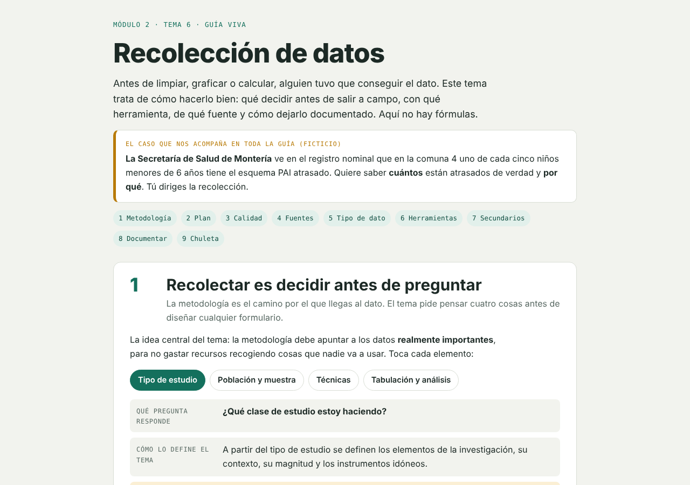
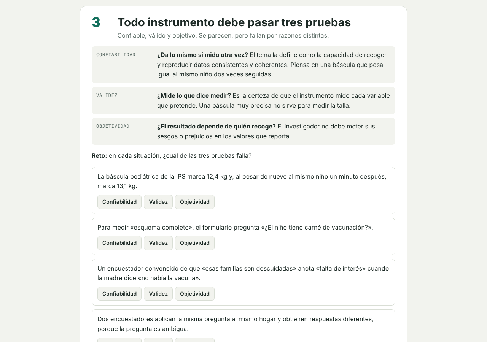

# Recolección de datos · Guía interactiva

Guía de estudio interactiva sobre **cómo recolectar datos bien**: qué decidir antes de salir a campo, con qué instrumento, de qué fuente y cómo documentarlo. Todo se aprende sobre un caso de salud pública (ficticio) en Montería, Colombia.

**[▶ Abrir la guía](https://Sebastian6820.github.io/guia-recoleccion-datos/)**

## El caso

La Secretaría de Salud de Montería detecta en el registro nominal que en la comuna 4 uno de cada cinco niños menores de 6 años tiene el esquema PAI atrasado. Quiere saber **cuántos** lo están de verdad y **por qué**. El lector dirige la recolección y cada sección le exige tomar una decisión sobre ese estudio.

## Contenido

| # | Sección | Qué se practica |
|---|---|---|
| 1 | Metodología | Tipo de estudio, población y muestra, técnicas, tabulación |
| 2 | Plan | Interruptores para ver qué falla si se omite un paso del planeamiento |
| 3 | Calidad | Retos para distinguir confiabilidad, validez y objetividad |
| 4 | Fuentes | Clasificar fuentes primarias y secundarias (internas/externas) |
| 5 | Tipo de dato | La misma pregunta abierta vs. cerrada: números o palabras |
| 6 | Herramientas | Elegir el instrumento adecuado según la situación |
| 7 | Secundarios | Ficha técnica de una fuente existente: qué revisar antes de usarla |
| 8 | Documentar | Qué debe quedar registrado del proceso |
| 9 | Chuleta | Resumen para repasar antes de la evaluación |

Incluye notas de contexto colombiano (Resolución 8430 de 1993 sobre ética en investigación en salud y Ley 1581 de 2012 de protección de datos personales).

## Tecnología

Un solo archivo HTML con CSS y JavaScript sin dependencias. Es adaptable a móvil, tiene modo oscuro automático y está pensado para el teclado (estados de foco visibles y regiones `aria-live` para la retroalimentación).

## Autor

**Sebastián** · [GitHub](https://github.com/Sebastian6820) · [LinkedIn](https://www.linkedin.com/in/sebastianmartineztinoco-dataanalyst~)
